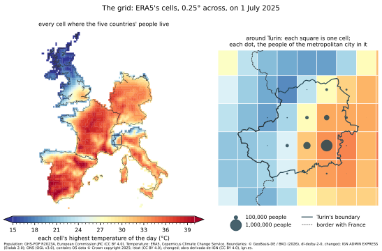
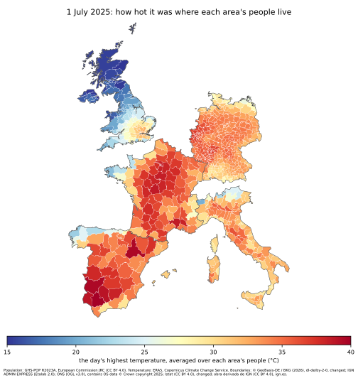
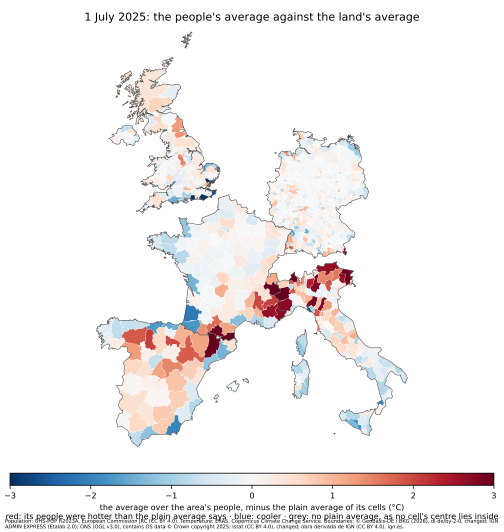
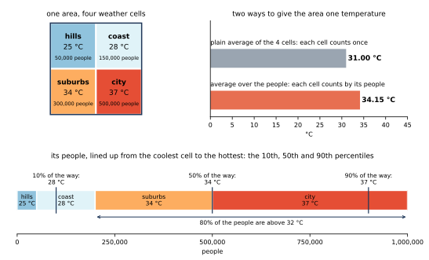

# terragrids

**Pre-release.** This package is in development, and its functions may still change
from one version to the next.

## What it does

To study how heat affects health, researchers set health statistics beside the weather.
That takes three maps, each cut into different pieces.

**1. Administrative areas, for health statistics.** Health statistics, such as deaths,
are published per administrative area. Each week,
[Eurostat](https://ec.europa.eu/eurostat/databrowser/view/demo_r_mwk3_t/default/table),
the European Union's statistical office, publishes the number of deaths in the small
regions of most European countries, such as Italy's provinces and France's départements.
Italy's and France's statistics institutes,
[Istat](https://www.istat.it/notizia/dati-di-mortalita-cosa-produce-listat/) and
[INSEE](https://www.insee.fr/fr/statistiques/7764286), publish them for each day.

**2. The weather grid.** Weather data comes as a grid of cells. The library is built for
[ERA5](https://doi.org/10.24381/cds.adbb2d47), a reconstruction of the weather of every
hour since 1940. The European Centre for Medium-Range Weather Forecasts (ECMWF) makes it,
and the European Union's Copernicus Climate Change Service publishes it under an open
licence. Its cells are 0.25° of latitude and longitude. A cell is about 28 km from north
to south everywhere. From east to west, it is about 22 km wide in southern Spain and
14 km in northern Scotland, as lines of longitude draw together towards the pole.

**3. The population grid.** A population grid estimates how many people live in each
small square of land. The examples here use
[GHS-POP](https://doi.org/10.2905/2FF68A52-5B5B-4A22-8F40-C41DA8332CFE), which the
European Commission's Joint Research Centre makes for the whole world, from census counts
and satellite images of buildings. Its squares are 30 arc-seconds across, about 1 km, so
900 of them, 30 by 30, fit in one weather cell.

Each area needs one value of the weather per day. But an area's borders don't follow the
weather cells, and its people are not spread evenly over them. `terragrids` is named for
these grids: it lays the weather grid and the population grid over the areas, and reads
the three together.



*1 July 2025. Left: every weather cell where people of Germany, France, the United
Kingdom, Italy or Spain live, coloured by the day's highest temperature. Right: one area,
the metropolitan city of Turin. Its boundary is drawn over the weather cells, and each
dot shows how many of its people live in that cell, counted on the population grid. Most
live on the hot plain to the east; few live in the cooler Alps to the west.*

`terragrids` does two things:

- **It computes established heat-stress measures** from ERA5: the heat index, the
  Universal Thermal Climate Index (UTCI) and the wet-bulb globe temperature (WBGT).
- **It turns the weather grid's values into one value per area.** It counts, on the
  population grid, how many of the area's people live in each weather cell, and weights
  each cell by that number. The value is the heat the area's people lived in, not the
  heat of its land.

It is for researchers and public-health analysts who study how heat affects health.



*1 July 2025, a heatwave day. Each area of Germany, France, the United Kingdom, Italy and
Spain is coloured by the day's highest temperature where its people live. The areas are
each country's small statistical regions, such as Germany's districts and France's
départements.*

## Why weight by people

The simple way to give an area one temperature is to average the weather cells inside
it. That gives an empty mountainside the same say as a city. On the day of the map above:

- **One area in five got no value at all:** 162 of 838 areas. They are smaller than a
  weather cell, so no cell's centre lies inside them. Most are cities, among them 93 of
  Germany's 400 districts.
- **Where both averages exist, they differ by more than 1 °C in one area in eight**
  (89 of 676).
  The people of the metropolitan city of Turin, most of them on the plain, had 31.9 °C.
  Its land, much of it in the Alps, averaged 27.3 °C.
- **One average can hide very different days.** In England's South East, a tenth of the
  people had 20.9 °C or less, by the sea, while a tenth had 31.7 °C or more, inland.



*The same day: how far the average over each area's people lies from the plain average of
its cells. Red: the people were hotter than the plain average says, as in the Alps and
the Pyrenees, where people live in the valleys. Blue: cooler, as on some coasts. Grey: no
plain average, as the area is smaller than a weather cell.*

`terragrids` weights each weather cell by the number of the area's people who live in
it, counted on the population grid. A cell where nobody lives counts for nothing.

## Why other measures of heat

A study of heat and health needs one number for how hot each day was. Most use the day's
mean air temperature: the average of its highest and lowest temperatures, or of its 24
hours. A review of 119 studies of extreme temperatures and health, published from 2014 to
2024, counted the measures they used (D'Ausilio et al., *Environmental Health*, 2026,
[doi:10.1186/s12940-026-01290-y](https://doi.org/10.1186/s12940-026-01290-y)). A study
may use more than one:

| Measure of the day's heat | What it adds to the mean air temperature | Studies |
|---|---|---|
| Mean air temperature | — | 87 |
| Highest air temperature | the hottest hour | 18 |
| Lowest air temperature | how warm the night stays | 11 |
| Mean apparent temperature | humidity | 6 |
| Universal Thermal Climate Index (UTCI) | humidity, wind and sun, through a model of the body | 2 |
| Wet-bulb globe temperature (WBGT) | humidity, wind and sun, as read by the instrument used to limit work and sport in heat | 1 |

The review found that the mean "was the dominant exposure metric, though rarely justified
over alternatives". In plain words, few of the studies said why they chose it.

The choice matters because the mean leaves out much of what the body feels. It averages
away the hottest hours. It ignores humidity, which slows the cooling of sweat, and the
sun. In the Rome example below, the air is 34 °C, and UTCI rates the hour 40.1 °C: very
strong heat stress.

Air temperature comes ready in weather data. The other measures must be computed hour by
hour, from humidity, wind and sunlight as well. `terragrids` computes the heat index,
UTCI and WBGT from ERA5 in a few lines of code. A study can then compare them, area by
area, and say why it chose one.

## What it gives you

For each area, and for each day or hour of data:

| Result | What it tells you |
|---|---|
| The average over the area's people | the heat its typical resident lived in |
| The 10th, 50th and 90th percentiles | how different its people's days were: a tenth of them were below the first, a tenth above the last |
| The share of its people above a threshold | for example, how many of them had more than 30 °C |
| The share of its people covered | how much of the area a value stands for, when some cells have no data |

It works with any boundaries you supply, and with any value on a grid: a temperature, or
one of the heat-stress measures below. The weights are built once for a set of areas,
then applied to as many days as you need. For Germany's 400 districts, on a laptop,
building them took about a second, and applying them to a day a few hundredths of a
second.

## Other tools

Parts of this already exist, and `terragrids` builds on some of them:

- **thermofeel**, ECMWF's library, computes the heat-stress measures. `terragrids` uses
  it, and prepares its inputs from ERA5.
- **exactextract** and **xagg** average a grid over areas, and can weight it by
  population. Neither has, built in, percentiles weighted by people or the share of an
  area's people that a value covers.
- **Ready-made datasets** exist for some places. TEE (*Scientific Data*, 2025) gives
  temperature measures for Europe's NUTS-2 and NUTS-3 regions from 1980 to 2024, some of
  them weighted by population. Two datasets give population-weighted heat index, WBGT and
  UTCI for US counties (2022) and US census tracts (2026).

`terragrids` puts the whole path in one library: from ERA5's variables to the three
measures, to values per area weighted by people counted on a 1 km population grid, with
their spread, a
threshold share and the share covered. It has been checked on real data in five
European countries.

## Installing

```
pip install terragrids
```

It needs Python 3.10 or later.

## Calculating values per area

An area of four weather cells: hills, a coast, suburbs and a city. Each cell has its own
temperature and its own number of people.



The code computes the same numbers. Here each cell's people are given as one point. With
real data, each square of the population grid becomes one point: its centre, and its
count of people.

```python
from shapely.geometry import box

from terragrids.areas import AreaWeights

# The grid's cell centres, 0.25° apart, and one area that covers all four cells.
lat, lon = [45.25, 45.0], [7.0, 7.25]
areas = {"example": box(6.875, 44.875, 7.375, 45.375)}

# Where the area's people live: hills, coast, suburbs, city.
people_lat = [45.25, 45.25, 45.0, 45.0]
people_lon = [7.0, 7.25, 7.0, 7.25]
people = [50_000, 150_000, 300_000, 500_000]
weights = AreaWeights.from_population(areas, people_lat, people_lon, people, lat, lon)

# Each cell's highest temperature of the day, in °C, by latitude then longitude.
hottest = [[25.0, 28.0], [34.0, 37.0]]

print(weights.apply(hottest).mean)  # [34.15]: the average over the people
print(weights.percentiles(hottest))  # [[28. 34. 37.]]: the 10th, 50th and 90th percentiles
print(weights.share_above(hottest, 32.0))  # [0.8]: 80% of the people had more than 32 °C
```

The plain average of the four cells is 31 °C, because it gives the hills, where 50,000
people live, the same say as the city, where 500,000 live.
[Values per area](docs/methodology/aggregation.md)
explains the method, and shows the five-country study with its maps.

## Calculating heat-stress measures

Three measures, each computed with thermofeel:

| Measure | What it captures | Method of `HeatStress` |
|---|---|---|
| Heat index | how hot shaded air feels, given its humidity | `heat_index` |
| Universal Thermal Climate Index (UTCI) | the body's response to air, humidity, wind and radiant heat | `utci` |
| Wet-bulb globe temperature (WBGT) | the reading of the instrument used to limit work and sport in heat | `wbgt_liljegren` (the default), `wbgt_mrt` |

`terragrids.era5` turns ERA5's variables into the inputs these methods need: `Era5`
converts wind, sunlight and pressure, and `Sun` computes the sun's angle. Every method
takes and returns kelvin, as ERA5 does; `Temperature` in `terragrids.units` converts to
and from degrees Celsius and Fahrenheit.

One hour in Rome on 15 July 2025, with illustrative values for each input:

```python
import numpy as np

from terragrids.era5 import Era5, Sun
from terragrids.measures import HeatStress
from terragrids.units import Temperature

t2m, d2m = 307.15, 291.15  # air 34 °C, dewpoint 18 °C
wind = Era5.wind_speed(1.5, 1.0)  # from the eastward and northward components, m/s
sp = Era5.pa_to_hpa(101000.0)  # surface pressure
ssrd, fdir = 3.0e6, 2.4e6  # sunlight over the hour, total and direct beam, J/m²
mrt = 333.15  # mean radiant temperature, as ERA5-HEAT publishes it

# The sun's angle averaged over the hour ending 13:00 UTC, ERA5's convention.
cossza = Sun.cos_zenith_hourly(np.datetime64("2025-07-15T13:00"), 41.9, 12.5)

sunlight = Era5.accumulation_to_rate(ssrd)  # W/m², the mean over the hour
direct = Era5.direct_fraction(fdir, ssrd)  # share of sunlight arriving as a direct beam

celsius = Temperature.kelvin_to_celsius
print(celsius(HeatStress.heat_index(t2m, d2m)))  # 35.1 °C
print(celsius(HeatStress.utci(t2m, d2m, wind, mrt)))  # 40.1 °C: very strong heat stress
print(celsius(HeatStress.wbgt_liljegren(t2m, d2m, sp, wind, sunlight, direct, cossza)))  # 31.0 °C
print(celsius(HeatStress.wbgt_mrt(t2m, d2m, wind, mrt)))  # 28.3 °C
```

Each function's documentation explains how to read its values, with typical ranges
and examples. [How the measures are computed](docs/methodology/heat_stress.md) explains
the methods, how they were checked, and why the published WBGT uses Liljegren's.

## What comes next

Terragrids will publish the results for Europe as an open dataset: the three measures,
weighted by people, for every day and every NUTS-3 region, ready to join with health
data. NUTS-3 regions are the small statistical areas Eurostat uses, each with roughly
150,000 to 800,000 people. The dataset does not exist yet.

## Licence

Apache License 2.0. See [LICENSE](LICENSE) and [NOTICE](NOTICE).

## Documentation

| Page | What it explains |
|---|---|
| [Values per area](docs/methodology/aggregation.md) | how the population weights work, with a worked example, and the five-country study with its maps |
| [Heat-stress measures](docs/methodology/heat_stress.md) | how the three measures are computed from ERA5, how they were checked, and why the default WBGT uses Liljegren's method |
