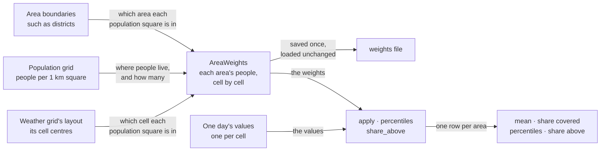
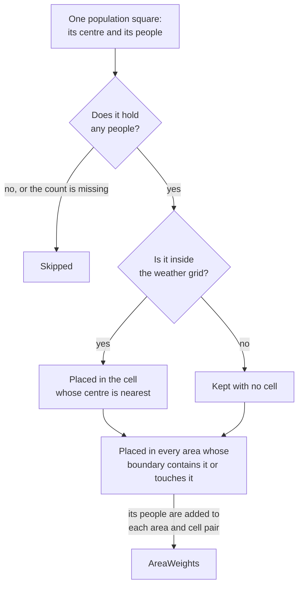
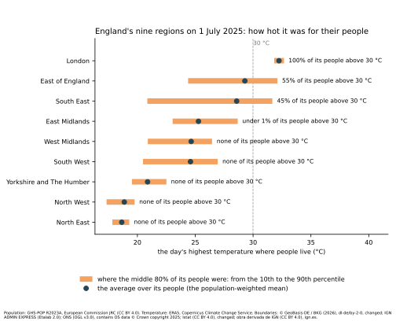
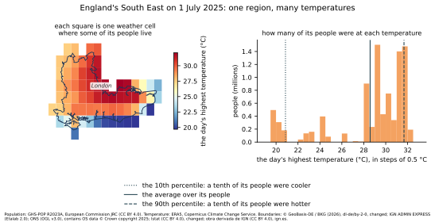

# Values per area

This document explains how the `terragrids` library turns weather on a grid into one
value per administrative area, such as a district or a county, by weighting each part
of the grid by the people who live there. It then
shows what that changes, on real data from five countries. It is written for a
researcher or reviewer who has not worked with gridded weather data before.

## Overview

A study of heat and health sets health statistics beside the weather. That takes three
maps, each cut into different pieces.

**1. Administrative areas, for health statistics.** Health statistics are published per
area. Istat, Italy's national statistics institute, for example, publishes each day's
deaths in every municipality. Eurostat, the European Union's statistical office,
publishes each week's deaths in the small regions of most European countries. The
[five-country study](#the-five-country-study) lists who publishes them for each of its
countries.

**2. The weather grid.** Weather data comes as a grid of **cells**. **ERA5** is a
reconstruction of the weather of every hour since 1940. The European Centre for
Medium-Range Weather Forecasts (ECMWF) makes it, and the European Union's Copernicus
Climate Change Service publishes it under an open licence. Its cells are 0.25° of
latitude by 0.25° of longitude. A cell is about 28 km from north to south everywhere.
From east to west, it is about 22 km wide in southern Spain and 14 km in northern
Scotland, as lines of longitude draw together towards the pole.

**3. The population grid.** A **population grid** estimates how many people live in each
small square of land. The study below uses **GHS-POP**, the population grid of the Global
Human Settlement Layer. The European Commission's Joint Research Centre makes it for the
whole world, by spreading census counts over the buildings seen in satellite images. Its
squares are 30 arc-seconds across, about 1 km, so 900 of them, 30 by 30, fit in one
weather cell.

To compare deaths with the weather, each area needs one value of the weather per day.
But an area's borders don't follow the weather cells, and its people are not spread
evenly over them. The library is named for these grids: it lays the weather grid and the
population grid over the areas, and reads the three together.

The figure shows the three together, as the study below uses them. On the left is every
weather cell where people of the five countries live, coloured by its highest
temperature on 1 July 2025. On the right is a closer look at one area, the metropolitan
city of Turin. Its boundary is drawn over the weather cells. Each dot shows how many of
the area's people live in that cell, counted on the population grid.


Most of Turin's people live in a few hot cells to the east, on the plain. The cells to
the west, over the Alps, are much cooler, and few people live in them.

The simple way is to average the weather cells inside the area. That gives every cell the same
say, however many people live in it. Take an area with a city cell at 36 °C, where
900,000 people live, and a countryside cell at 30 °C, where 100,000 live:

| Method | Calculation | Result |
|---|---|---|
| Plain average of the cells | (36 + 30) / 2 | 33 °C |
| Average over the people | (900,000 × 36 + 100,000 × 30) / 1,000,000 | 35.4 °C |

The plain average describes the area's land. The average over the people describes the
heat that nine in ten of its residents were in, which is what a health study needs.

The library computes the second. It weights each weather cell by the number of the area's
people who live in it, counted on the population grid. A cell where nobody lives counts
for nothing. For each area it gives four results:

| Result | What it tells you | Method of `AreaWeights` |
|---|---|---|
| The average over the area's people | the heat its typical resident lived in | `apply(...).mean` |
| The share of its people covered | how much of the area the average stands for | `apply(...).covered` |
| The 10th, 50th and 90th percentiles | how different its people's days were | `percentiles` |
| The share of its people above a threshold | for example, how many had more than 30 °C | `share_above` |

The work comes in two steps, shown below. The **weights** record who lives in which area
and which cell. They are built once, from the boundaries, the population and the grid's
layout, and can be saved. They are then applied to each day's values.



The first step is the slow one, and it never needs the weather values. The second needs
nothing but the weights and the values, so it repeats quickly for every day of a long
record.

## Building the weights

Each square of the population grid is passed to the library as a **point**: the
latitude and longitude of its centre, and its count of people.

`AreaWeights.from_population` decides, for every point, which cell and which areas it
belongs to. The diagram shows the path one point takes.



Three things follow from it:

- **A point outside the grid is not lost.** A grid cut to a rectangle, such as Europe's,
  may miss part of an area. Those people stay in the area's population, with no cell, so
  the area's share of people covered shows the gap.
- **A point on a border counts in both areas.** In the study below, this added no
  measurable number of people: the share counted twice rounds to 0 at five decimals, in
  every country.
- **Each point is placed by its centre.** A population square split by a boundary goes
  whole to the area that contains its centre.

The weights can be saved with `AreaWeights.save` and read back with `AreaWeights.load`.
The same weights then give the same values at every later use.

## What each area gets

The figure works through one area of four cells: hills, a coast, suburbs and a city,
each with its own temperature and its own number of people. The library computed every
number in it ([`aggregation_example.py`](aggregation_example.py) draws it).


**The average over the people** is 34.15 °C. The plain average of the four cells is 31 °C,
because it gives the hills, where 50,000 people live, the same say as the city, where
500,000 live.

**The percentiles** describe how different the people's days were. Line up the area's
1,000,000 people from the coolest cell to the hottest. The 10th percentile is the value of
the cell where the person 10% of the way along lives:

- the 10th percentile is 28 °C, because the 100,000th person lives on the coast;
- the 50th percentile is 34 °C, because the 500,000th person is the last in the suburbs;
- the 90th percentile is 37 °C, because the 900,000th person lives in the city.

Each percentile is one cell's real value, never a value between two cells.

**The share above a threshold** counts the people in cells above it. Above 32 °C, it is
0.8: the 800,000 people in the suburbs and the city. A value equal to the threshold is not
above it.

**The share of people covered** says how much of the area a value stands for. A cell can
lack a value on some day, and part of an area can lie outside the grid. Those people are
left out of the average, and the share drops below 1. The two-cell area from the overview,
in three cases:

| Case | Average over the people | Share of the people covered |
|---|---|---|
| Both cells have a value | 35.4 °C | 1,000,000 / 1,000,000 = 1 |
| The countryside cell has no value that day | 36 °C | 900,000 / 1,000,000 = 0.9 |
| 50,000 more of its people live outside the grid | 35.4 °C | 1,000,000 / 1,050,000 ≈ 0.95 |

A share below 1 tells the reader that the value leaves part of the area's people out.
They can then use the value, mark it or drop it. The percentiles and the share above a
threshold count only the people covered, too.

## Using it

The library takes the boundaries, the population points and the grid as arrays. It
downloads nothing. A sketch, for a year of daily values:

```python
from terragrids.areas import AreaWeights

weights = AreaWeights.from_population(
    boundaries,  # each area's code and its shapely polygon, in longitude and latitude
    people_lat, people_lon, people,  # one point per population square
    era5_lat, era5_lon,  # the grid's cell centres, as in the ERA5 file
)
weights.save("districts.npz")  # build once; AreaWeights.load reads it back

hottest = ...  # each cell's highest temperature of each day: shape (days, lat, lon)
values = weights.apply(hottest)  # values.mean and values.covered: shape (days, areas)
spread = weights.percentiles(hottest)  # shape (days, areas, 3): 10th, 50th, 90th
hot = weights.share_above(hottest, 30.0)  # shape (days, areas)
```

The values can be any measure on the grid: a temperature, or a heat-stress measure such
as UTCI. The grid may give its longitudes from −180 to 180 or from 0 to 360, and its
latitudes in either order, as ERA5 files do. The study's script,
[`aggregation_study.py`](aggregation_study.py), shows the whole path on real data, from
the downloads to the maps.

## The five-country study

The study ran the weights on real data for one day: 1 July 2025, when that summer's
heatwave reached the capitals of all five countries. The value is each ERA5 cell's
highest temperature of the day, the maximum of its 24 hourly air temperatures at 2 m.

It covers each country's **NUTS-3** regions: the small statistical areas Eurostat uses
across Europe, built from each country's own provinces, districts or départements. The
United Kingdom uses ITL3 regions, its own equivalent. The table shows, for each country,
who publishes deaths for these areas and how often.

| Country | Areas | Deaths published | Boundaries |
|---|---|---|---|
| Germany | 400 districts | each year, by the [Federal Statistical Office](https://www.regionalstatistik.de/genesis/online?operation=table&code=12613-01-01-4) (Destatis); each week only for the 16 states | VG250, the Federal Agency for Cartography and Geodesy (BKG) |
| France | 101 départements | each day, by the [national statistics institute](https://www.insee.fr/fr/statistiques/7764286) (INSEE); each week, by [Eurostat](https://ec.europa.eu/eurostat/databrowser/view/demo_r_mwk3_t/default/table) | ADMIN EXPRESS, the national mapping agency (IGN) |
| United Kingdom | 182 ITL3 regions | each month, per local authority of England and Wales, by the [Office for National Statistics](https://www.ons.gov.uk/peoplepopulationandcommunity/birthsdeathsandmarriages/deaths/datasets/monthlyfiguresondeathsregisteredbyareaofusualresidence) (ONS); Scotland and Northern Ireland publish their own | the Office for National Statistics (ONS) |
| Italy | 110 provinces and metropolitan cities | each day, per municipality, by the [national statistics institute](https://www.istat.it/notizia/dati-di-mortalita-cosa-produce-listat/) (Istat); each week, by Eurostat | the national statistics institute (Istat) |
| Spain | 50 provinces, and the cities of Ceuta and Melilla | each week, by the [national statistics institute](https://www.ine.es/dynt3/metadatos/es/RespuestaDatos.html?oe=30324) (INE) and by Eurostat | the national geographic institute (IGN) |

Of the sources in the table, only France's and Italy's count deaths for each day.
Italy's counts per municipality add up to its provinces. Elsewhere, a study works with
weekly, monthly or yearly counts.

It also ran two sets of larger areas: England's nine regions, and Germany as a whole.
Every result is in [`aggregation_study_2025_07_01.json`](aggregation_study_2025_07_01.json),
with the address and the SHA-256 fingerprint of every input. **SHA-256** is a short code
computed from a file's bytes, which changes if any byte does, so it shows exactly which
file was used.

### How the weather depends on where people live

The first map shows each area's average over its people.


The heat ran from 14 °C in Northern Ireland to 40 °C in Seville. Germany's people
averaged 34.0 °C. Four in five of them were between
31.2 °C and 36.6 °C, and 95% were above 30 °C.

The second map compares the average over the people with the plain average of the cells
whose centres lie inside the area. Red areas are where the people were hotter than the
plain average says; blue, where they were cooler.


Three things stand out:

- **For 162 of the 838 areas on the European grid, the plain average has no value at
  all.** These areas are smaller than a cell, so no cell's centre lies inside them, and
  they show in grey. Most are cities: 93 of Germany's 400 districts, and 61 of the
  United Kingdom's 182 regions. The weights give each of them a value, from the cells
  where its people live.
- **In mountain areas the people were hotter than the land.** People live in the valleys,
  and the cells over the peaks are cooler. Turin's people averaged 31.9 °C, while the
  cells of the metropolitan city of Turin, much of it in the Alps, averaged 27.3 °C.
  Savoie's people had 29.3 °C against 24.6 °C, and Lleida's 37.5 °C against 33.3 °C.
- **On some coasts the people were cooler than the land.** In the south-west of West
  Sussex, where most people live by the sea, they averaged 22.2 °C, while the area's
  cells averaged 29.5 °C.

Of the 676 areas with both values, 89 differ by more than 1 °C, and 25 by more than
2 °C:

| Country | Areas with both values | Differ by more than 1 °C | By more than 2 °C |
|---|---|---|---|
| Germany | 307 | 11 | 1 |
| France | 93 | 20 | 7 |
| United Kingdom | 121 | 12 | 4 |
| Italy | 107 | 29 | 11 |
| Spain | 48 | 17 | 2 |

### How different one area's days can be

A large area holds people in very different places. The chart shows England's nine
regions. The bar runs from each region's 10th to its 90th percentile, so the middle 80% of
its people were on it. The dot is the average over its people.



London is one city, and its bar is short: 80% of its people were within 0.9 °C of each
other, and all of them were above 30 °C. The South East's bar is the longest, from
20.9 °C to 31.7 °C. Its average of 28.6 °C describes few of its people, as the next figure
shows.



Its people fall into two groups. About a million live along the coast, where the sea kept
the day near 20 °C. Most of the rest live inland, around London, at 28 °C to 32 °C. The
gap in the middle of the map is London itself, a region of its own. A study that used the
average alone would treat the whole region as one day at 28.6 °C.

### Checks

**The areas' populations match the official counts.** The table compares each area's
people from the weights with its official count, as a ratio: 1 means they agree.

| Country | Areas compared | Middle ratio | Lowest | Highest |
|---|---|---|---|---|
| Germany | 400 | 0.98 | 0.87 | 1.25 |
| France | 101 | 0.98 | 0.88 | 1.12 |
| United Kingdom | 181 | 0.98 | 0.85 | 1.22 |
| Italy | 103 | 0.97 | 0.85 | 1.11 |
| Spain | 52 | 0.91 | 0.80 | 1.07 |

The official counts are Eurostat's for 1 January 2025, and the ONS's mid-2024 estimates
for the United Kingdom. Where one official count covers several areas, their sum is
compared: Sardinia's eight provinces as one, the island provinces of Spain from their
islands, and two Scottish regions that share a council.

The differences come from the population grid, not from the weights. GHS-POP is a model:
it spreads census counts over the land, using satellite images of buildings, and its 2025
figures are projected from earlier censuses. Spain's population grew fast after its last
census, which likely explains its lower ratios. The average over an area's people depends
on how its people are spread across its cells, not on their total, so a total that is a
few percent off moves the average only if the model misplaces people within the area.

**Every area on the grid is fully covered.** The European grid runs from 34°N to 72°N and
from 25°W to 45°E. Spain's two Canary Island provinces lie south of it, so on that grid
their share of people covered is 0. A second run on a grid around the islands covers them
fully, and the study keeps, for each area, the run that covers more of its people. France's
five overseas regions lie outside both grids, and keep a share of 0.

**The weights are quick to build and quicker to apply.** Measured on one laptop computer;
another machine will differ, and times vary a little from one run to the next.

| Country | Population points | Building the weights | Their peak memory | Applying them to the day |
|---|---|---|---|---|
| Germany | 677,670 | 1.4 s | 43 MB | 0.04 s |
| France | 1,133,070 | 1.1 s | 71 MB | 0.01 s |
| United Kingdom | 441,295 | 0.6 s | 28 MB | 0.02 s |
| Italy | 611,278 | 0.4 s | 39 MB | 0.01 s |
| Spain | 608,958 | 0.6 s | 38 MB | 0.01 s |

## Limits

- **It sees nothing smaller than a cell.** A city's hot centre and its cooler parks share
  one ERA5 value. The weights decide which cells count for an area, and how much; they
  cannot add detail inside a cell.
- **It counts people where they live.** The population grid places people at home. It
  does not follow them to work, or count tourists, and one year's grid is used for every
  day.
- **The population is a model.** GHS-POP's counts differ from official ones by a few
  percent per area, as the checks show.
- **It brings no data.** The user supplies the boundaries, the population and the
  gridded values. The study's script shows one way to fetch them.
- **The study shows one day.** It shows what weighting by people changes on a heatwave
  day, not how large the difference is on average over years. On other days it may be
  smaller or larger.
- **The comparison uses one plain method.** The plain average here takes the cells whose
  centres lie inside the area, each once. Other tools weight each cell by the share of its
  land inside the area, which gives different numbers, not computed here.
- **It does not link the values to health outcomes yet.** That is the next step: an open
  dataset of daily values for Europe's areas, ready to join with health data.

## Sources and credits

- **Population:** GHS-POP R2023A, epoch 2025. Schiavina et al. (2023), European
  Commission, Joint Research Centre, doi:10.2905/2FF68A52-5B5B-4A22-8F40-C41DA8332CFE,
  CC BY 4.0.
- **Temperature:** ERA5 hourly data on single levels. Hersbach et al. (2023), Copernicus
  Climate Change Service, doi:10.24381/cds.adbb2d47. Contains modified Copernicus Climate
  Change Service information 2025.
- **Germany:** © GeoBasis-DE / BKG (2026), VG250 districts, dl-de/by-2-0; data changed.
- **France:** IGN, ADMIN EXPRESS COG CARTO 4.0 (2026), Licence Ouverte / Etalab 2.0.
- **United Kingdom:** Source: Office for National Statistics, licensed under the Open
  Government Licence v3.0. Contains OS data © Crown copyright and database right 2025.
- **Italy:** Istat, Confini delle unità amministrative a fini statistici al 1° gennaio
  2026 (*boundaries of the administrative units for statistical purposes, 1 January
  2026*), CC BY 4.0; data changed.
- **Spain:** Obra derivada de Unidades administrativas (INSPIRE) (*a work derived from
  the administrative units*), CC BY 4.0, ign.es.
- **Official populations:** Eurostat, demo_r_pjanaggr3, 1 January 2025. Office for
  National Statistics, mid-2024 estimates, via Nomis, Open Government Licence v3.0. Where
  areas are summed, the sums are ours; Eurostat bears no responsibility for them.

## Files

| File | What it holds |
|---|---|
| [`aggregation_study.py`](aggregation_study.py) | the study: it downloads the inputs, builds and applies the weights, and draws the maps |
| [`aggregation_study_2025_07_01.json`](aggregation_study_2025_07_01.json) | every result, with each input's address and fingerprint |
| [`aggregation_example.py`](aggregation_example.py) | draws the four-cell example from the library's own results |
| [`figures/`](figures/) | the maps and charts, as SVG |
