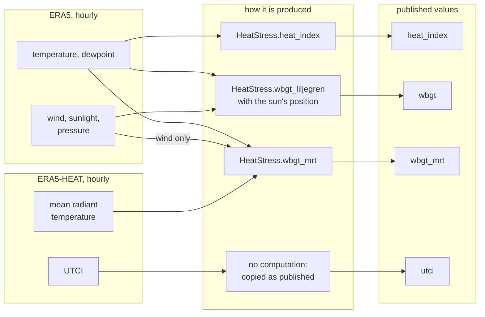
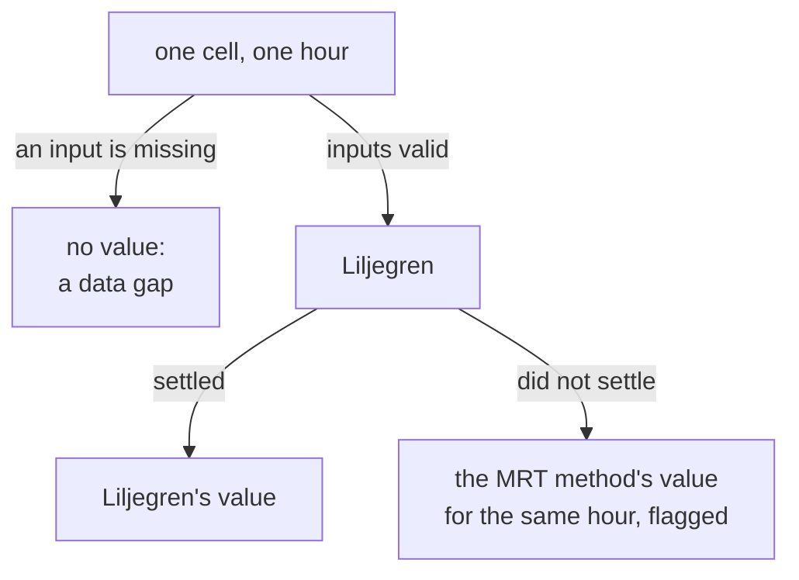

# Heat-stress measures

This document explains how the `terragrids` library computes its heat-stress measures,
how they were checked, and why the published wet-bulb globe temperature uses the
method it does. It is written for a researcher or reviewer who has not worked with
these measures before.

## Overview

A **heat-stress measure** turns several weather variables into one number that tracks
how hard heat is on the human body. Air temperature alone misses most of it. Humid air
slows the evaporation of sweat, wind carries heat away from the skin, and sunshine adds
heat that a thermometer in the shade never sees.

The library computes three established measures:

| Measure | What it captures | Inputs | Method of `HeatStress` |
|---|---|---|---|
| Heat index | how hot shaded air feels, given its humidity | temperature, humidity | `heat_index` |
| Universal Thermal Climate Index (UTCI) | the body's response to air, humidity, wind and radiant heat | temperature, humidity, wind, radiant heat | `utci` |
| Wet-bulb globe temperature (WBGT) | the reading of an instrument used to limit work and sport in heat | temperature, humidity, wind, sunshine, sun position, pressure | `wbgt_liljegren` (the default), `wbgt_mrt` |

None of the formulas is new. Every one comes from **thermofeel**, the library of the
European Centre for Medium-Range Weather Forecasts (**ECMWF**), version 2.3. The
contribution of `terragrids` is to fix which formula each measure uses, to prepare
the inputs correctly from ERA5, and to check the results.

**ERA5** is ECMWF's reanalysis: a reconstruction of past weather, hour by hour, on a
grid of cells 0.25° of latitude and longitude across (about 28 km north to south).
**ERA5-HEAT** is ECMWF's dataset of hourly heat-stress values computed from ERA5. It
publishes UTCI and the mean radiant temperature.

The diagram shows how each published value is produced, and from which data.

The boxes on the right are the published values. The heat index and both WBGT values
are computed by the library from ERA5, with ERA5-HEAT's mean radiant temperature for
the second WBGT method. UTCI is not computed at all: the published value is
ERA5-HEAT's own, copied as it is.

The library also has a `utci` function, which does not appear in the diagram because
the published data does not use it. It is for data that comes without a ready-made
UTCI, such as a weather forecast. The study below runs it on ERA5 to show how closely
it matches ERA5-HEAT.

## Reading the three measures

All three are temperatures. The library returns them in kelvin, as ERA5 does;
`Temperature`, in `terragrids.units`, converts to degrees Celsius or Fahrenheit.

**Heat index.** The shaded air temperature that would feel as hot at a moderate
humidity. The US National Weather Service (NWS) reads it in four bands: 27–32 °C
caution, 32–41 °C extreme caution, 41–54 °C danger, above 54 °C extreme danger. For
example, 35 °C air at 50 % relative humidity has a heat index of 40.7 °C, and 32 °C
air at 70 % has 40.4 °C: cooler, more humid air can be as hard on the body. The heat
index ignores sunshine and wind.

**UTCI.** The air temperature of a reference environment that would strain the body
as much as the actual one. The reference environment has light wind (0.5 m/s at
10 m), no extra radiant heat, and moderate humidity. Its heat side runs 26–32 °C
moderate, 32–38 °C strong, 38–46 °C very strong, above 46 °C extreme heat stress.
For example, 30 °C air with a 2 m/s wind gives a UTCI of 28.9 °C in shade and 36.5 °C
in full sun.

**WBGT.** Explained in the next section. It runs well below the air temperature,
because its largest part is an evaporation-cooled thermometer. KNMI, the Dutch
national weather service (Koninklijk Nederlands Meteorologisch Instituut, Royal
Netherlands Meteorological Institute), reads it on a 0–10 heat scale in 2 °C steps
from 14 °C to 32 °C.

Each function's documentation gives more examples. Every example value there is
checked by the library's tests.

## WBGT and its two methods

### The instrument

WBGT is not a formula. It is the reading of a physical instrument, devised for US
military training camps in the 1950s after recruits collapsed from heat. The
instrument has three thermometers:

- a **natural wet-bulb** thermometer: a wet wick in the open air, cooled by
  evaporation, so it stands for how well sweat can cool the body;
- a **black globe** thermometer: a hollow black ball in the sun, which stands for heat
  from sunshine and warm surfaces;
- an ordinary **shaded** thermometer for the air temperature.

**WBGT = 0.7 × natural wet-bulb + 0.2 × globe + 0.1 × air.**

ERA5 has no such instrument. Any gridded WBGT is therefore an estimate of what the
instrument would have read, worked out from the weather. There are two ways to make
that estimate, and thermofeel provides both.

### The two methods

**Liljegren's method** (`wbgt_liljegren`; Liljegren et al., 2008) models the
instrument's physics. It works out how much sunshine the black ball absorbs, how much
heat the wind carries away from it, and how fast the wick evaporates. It solves for
the globe and wick temperatures by repeated correction until the answer settles. It
needs sunshine, the share of sunshine arriving as a direct beam, the sun's position,
wind, humidity and pressure. It is the method the occupational-health literature
treats as the reference for outdoor WBGT, and KNMI runs it operationally.

**The method from the mean radiant temperature** (`wbgt_mrt`; Brimicombe et al.,
2023) takes a shortcut. The **mean radiant temperature (MRT)** is the uniform surface
temperature that would give the body the same radiant heat as the actual sun, sky and
ground; ERA5-HEAT publishes it. From it, the globe temperature follows in a closed
formula (Guo et al., 2018). The wet-bulb part is Stull's (2011) fitted formula, which
gives the reading of a shaded, ventilated thermometer, not of a wick in the open.

The two differ most where that last difference matters. Take two afternoons, both
32 °C in the shade:

- **overcast, with a breeze:** the wick barely feels the sun, and both methods agree
  closely;
- **clear sky, still air, midday sun:** the sun warms the wick, which the MRT method's
  wet-bulb leaves out. The MRT method reads lower.

That second afternoon is the one the published data exists for.

### What `terragrids` adds to Liljegren's method

thermofeel's Liljegren function is configured as KNMI runs it:

- the 10 m wind is raised to at least 0.62 m/s, then converted to the instrument's 2 m
  height by Liljegren's stability-dependent profile, with the urban exponents;
- the direct share of sunshine is capped at 0.9, and set to 0 when the sun is at or
  below 89.5° from overhead.

The library prepares its inputs from ERA5, with `Era5` and `Sun` in `terragrids.era5`:

| Input | ERA5 variable | ERA5's form | Conversion |
|---|---|---|---|
| air temperature | `t2m`, at 2 m | K | none |
| dewpoint | `d2m`, at 2 m | K | relative humidity by the Magnus formula, inside thermofeel |
| wind speed | `u10`, `v10`, at 10 m | eastward and northward components, m/s | combined into one speed |
| sunshine | `ssrd` | energy over the hour, J/m² | divided by 3,600 s to W/m² |
| direct share | `fdir` and `ssrd` | energy over the hour, J/m² | `fdir / ssrd`, clipped to 0–1, 0 without sun |
| pressure | `sp` | Pa | divided by 100 to hPa |
| sun position | not published | — | computed: the cosine of the sun's angle from overhead, averaged over the hour |

### The sun's position

Liljegren's method needs the sun's position, which ERA5 does not publish. The library
computes it as the **cosine of the solar zenith angle**: the angle between the sun and
the point directly overhead. The cosine is 1 with the sun overhead, falls as the sun
gets lower, and is 0 at sunrise, at sunset and through the night.

ERA5 stamps an hourly total at the end of the hour it covers: the sunshine stamped
14:00 fell between 13:00 and 14:00. So the sun's position must be averaged over the
same hour, not taken at one instant. Around sunrise and sunset the difference is
large, because the sun is up for only part of the hour.

The formula is the one ECMWF's earthkit-meteo library uses (Hogan and Hirahara, 2016).
The library computes it with the full time of day, and is accurate to 0.007 in the
cosine against the solar-position algorithm of the US National Renewable Energy
Laboratory (NREL).

Releases of earthkit-meteo before 1.2.1 dropped the minutes from the time of day, so
their hour average was the value at the start of the hour. In London's sunrise hour on
21 June 2025 (sun up at about 03:43 UTC), they return 0, while the true average is
small but positive. Measured against NREL, their error reaches about 0.1 in the
cosine, around 136 W/m² of sunshine at the top of the atmosphere. Release 1.2.1 fixed
this, and a test in the library checks that the two hour averages now agree to within
0.0001.

The library keeps its own copy of the formula for two reasons:

- **It averages many hours in one call.** earthkit-meteo's function takes one hour at
  a time, so a year of hours would need a loop of 8,760 calls.
- **It needs no further packages.** Using earthkit-meteo would add it and four
  packages it depends on to every installation of the library.

### Missing values

Liljegren's repeated correction can, in rare conditions, fail to settle. thermofeel then
returns no value (NaN, "not a number") for that cell and hour. The library never fills
it silently.

The diagram follows one cell and hour.

A missing input stays a gap. A failure of Liljegren's solver is filled with the MRT
method's estimate for the same hour, and the fill is flagged. Leaving it as a gap
would bias the results low, because failures are likeliest in strong sun and still
air, when WBGT peaks. The published data will carry, for each area and day, the share
of hours that were filled. In the July 2025 study below, no hour needed filling.

## Validation

### Against published reference values

The library's tests check each measure against an independent source, transcribed
separately from thermofeel:

| Measure | Reference | Agreement |
|---|---|---|
| Heat index | the NWS regression and adjustments (Rothfusz, 1990; NWS Weather Prediction Center), and three points of the NWS chart | within 0.01 °F of the regression; within 2 °F of the chart, which allows for its rounding and the regression's stated ±1.3 °F |
| UTCI | its definition: in the reference environment UTCI equals the air temperature (Bröde et al., 2012) | within 0.5 °C from 20 °C to 45 °C |
| WBGT, Liljegren | Liljegren's original code (WBGT version 1.1, Argonne National Laboratory, 2008), every step | within 0.01 °C in six cases; within 0.008 °C over 4,001 random cases |
| WBGT, MRT method | Stull's (2011) worked example, and the identity that in shade WBGT = 0.7 × wet-bulb + 0.3 × air | exact |
| Sun position | NREL's solar-position algorithm, through pvlib | within 0.007 in the cosine |

One finding along the way: Liljegren's original code cannot compute the globe
temperature with the sun exactly at the horizon or below, because it divides by the
cosine. thermofeel handles that case, which matters because the library's cosine is
exactly 0 at night.

### On a month of real data

A study ran both WBGT methods, and the other checks, on ERA5 for Europe in July 2025:
31 days, 744 hours, 42,993 cells, of which the land cells give 14.9 million cell-hours.
Its checks ask different kinds of question, and only some of them bear on the choice
of method:

| Check | The question it asks | Bears on the choice? | Result |
|---|---|---|---|
| Convergence | Does Liljegren always produce a value? | yes: a precondition | settled at every one of 14.9 million land cell-hours |
| Hottest hour | Do its failures ever hit a cell's hottest hour of the day? | yes: a precondition | never: no hour needed filling |
| Timing | Is Liljegren's sun-position input right? | yes: a precondition | right (see below) |
| Gap | Does the choice of method matter? | yes: the reason to choose at all | yes: 2.8 °C apart on average on hot days |
| UTCI | Does the library's UTCI match ERA5-HEAT's? | no: a separate finding | 0.8 °C apart at the median |

**Convergence and hottest hour.** Liljegren settled everywhere, so the fill was never
used.

**Timing.** Only Liljegren uses the sun's position, so a wrong position would make
Liljegren wrong. The check uses sunlight at the top of the atmosphere, where there are
no clouds. Sunlight arrives there with one brightness, about 1,315 W/m² in July, on a
surface facing the Sun squarely, and at a given moment that brightness is the same
wherever it arrives. A flat patch receives that brightness times the cosine: all of it
with the sun overhead, about 395 W/m² with the sun low (cosine 0.3), nothing at night.
A torch shining on a ball is equally bright for the whole ball, but the side facing
it is lit fully, the slanted sides less, and the back not at all.

ERA5 publishes what each cell receives at the top of the atmosphere, hour by hour.
Dividing it by the library's cosine must give back the same brightness in every
sunlit cell. The study measured how much those per-cell numbers disagree within each
hour (the standard deviation divided by the mean). To show the test can tell right
from wrong, it repeated it with two deliberate mistakes:

| Version | Typical disagreement within an hour |
|---|---|
| the library: the hour ending at the timestamp | 0.65 % (0.30 % without cells where the sun is barely up) |
| mistake: the sun's position at the start of the hour | 18.5 % |
| mistake: the hour starting at the timestamp | 32 % |

The recovered brightness was 1,313 W/m², as expected for July. Nearly all of the
library's remaining disagreement comes from cells with the sun just above the horizon,
where the check divides by a tiny cosine and magnifies small differences between
ECMWF's sun formula and the library's.

**Gap.** On hot days, land cell-days where Liljegren's daily maximum reaches 25 °C,
Liljegren read higher than the MRT method on every one of the 272,709:

| | Mean | Median | 95th percentile | Largest |
|---|---|---|---|---|
| Liljegren − MRT method, daily maximum | 2.8 °C | 2.6 °C | 4.8 °C | 7.1 °C |

The choice therefore matters: a 2.8 °C difference spans more than one 2 °C WBGT risk
band. The direction is the one the methods predict, since the MRT method's wet-bulb
leaves out the sun on the wick. The study had no measured WBGT, so on its own it shows
that the methods differ, not which is right. The case for Liljegren is that it models
the instrument WBGT is defined by, and was checked against real instruments when it
was published.

**UTCI.** Given ERA5's inputs and ERA5-HEAT's mean radiant temperature, the library's
`utci` does not exactly reproduce ERA5-HEAT's published UTCI:

| | Mean | Median | 90th percentile | 99th percentile | Largest |
|---|---|---|---|---|---|
| \|library − ERA5-HEAT\| on land | 1.0 °C | 0.8 °C | 2.1 °C | 3.7 °C | 15.7 °C |

There is no overall bias. The difference is larger where the weather changes sharply
between neighbouring cells: at 13:00 UTC on 15 July the median was 0.4 °C in the
smoothest quarter of cells and 1.2 °C in the roughest twentieth. That fits ERA5-HEAT computing UTCI on
ECMWF's own model grid before regridding to 0.25°. It does not explain all of it.
The published data takes UTCI from ERA5-HEAT, so it is not affected. A user computing
UTCI with the library should expect differences of this size from the published
values.

## The default method

The published `wbgt` uses **Liljegren's method**. The MRT method is published beside
it as `wbgt_mrt`, for comparison and for sensitivity analyses.

**The rule.** A rule for choosing was fixed before the study ran. Liljegren would be
the default only if all five checks passed:

- timing: typical disagreement under 0.5 %, and under half of either mistake's;
- UTCI: 99th percentile of the difference at most 0.5 °C;
- convergence on at least 99 % of the hours of hot cell-days;
- the hottest hour filled on under 1 % of hot cell-days;
- the gap's 95th percentile at least 1.0 °C, half of a 2 °C risk band.

**What happened.** Under that rule the timing and UTCI checks failed, so the rule chose
the MRT method. Both failures were faults of the rule, not of Liljegren:

- the timing limit was set without allowing for cells with the sun barely up, where the
  check magnifies small formula differences;
- the UTCI check does not bear on WBGT, and should not have been part of the rule.

**The amendment.** The rule was amended after the results were seen. 
The timing limit now applies to cells with a sun
cosine above 0.1, where the library's disagreement is 0.30 %; the comparison with the
deliberate mistakes is unchanged. The UTCI check is reported as a finding and no longer
decides. Under the amended rule every check that bears on WBGT passes, and Liljegren is
the default. The original verdict, the amended one and every measurement are in
[`wbgt_study_2025_07.json`](wbgt_study_2025_07.json).

**When to use the MRT method instead.** When sunshine, its direct share or surface
pressure are unavailable but mean radiant temperature is; or to test how sensitive a
result is to the choice of method.

## Limits

- **The grid is coarse.** A 0.25° cell averages over towns, fields and water. The
  measures describe the cell's weather, not a street or a room. Urban heat islands and
  indoor heat are not resolved.
- **Reanalysis is a model.** ERA5 reconstructs past weather from observations and a
  forecast model. It is smoother than a station's record, especially for wind and
  humidity extremes.
- **WBGT assumes a standard instrument and setting.** The 2 m height, the urban wind
  profile and the globe size are fixed; real exposures vary.
- **The heat index ignores sun and wind.** Full sunshine can add up to about 8 °C to
  the felt heat, which it leaves out.
- **The study used one month, one region and UTC days.** The published data's day
  boundary is decided separately. The study did not compare against measured WBGT.
- **The study's code is not published.** Its method is described above and its
  results are in [`wbgt_study_2025_07.json`](wbgt_study_2025_07.json), but the script
  that produced them is not part of this repository, so the results cannot be
  rerun from here.
- **Each measure keeps the validity range of its formula,** stated in each function's
  documentation. Outside it, the formulas extrapolate.

## Versions and references

- thermofeel 2.3.0, https://github.com/ecmwf/thermofeel. Values are reproducible only
  with the same version, which the library pins to 2.3.
- Bröde, P., et al. (2012). Deriving the operational procedure for the Universal
  Thermal Climate Index (UTCI). *International Journal of Biometeorology*, 56.
  https://doi.org/10.1007/s00484-011-0454-1
- Brimicombe, C., et al. (2023). Wet Bulb Globe Temperature: indicating extreme heat
  risk on a global grid. *GeoHealth*, 7. https://doi.org/10.1029/2022GH000701
- Guo, H., et al. (2018). *Energy and Buildings*.
  https://doi.org/10.1016/j.enbuild.2018.08.029
- Hogan, R. J., and Hirahara, S. (2016). Effect of solar zenith angle specification in
  models on mean shortwave fluxes and stratospheric temperatures. *Geophysical Research
  Letters*, 43. https://doi.org/10.1002/2015GL066868
- KNMI (2026). Technical Report TR-26-04, Table 1 (the heat force scale, as cited by
  thermofeel).
- Kong, Q., and Huber, M. (2022). Explicit calculations of wet-bulb globe temperature
  compared with approximations and why it matters for labor productivity. *Earth's
  Future*, 10. https://doi.org/10.1029/2021EF002334
- Liljegren, J. C., et al. (2008). Modeling the wet bulb globe temperature using
  standard meteorological measurements. *Journal of Occupational and Environmental
  Hygiene*, 5(10), 645–655. https://doi.org/10.1080/15459620802310770
- Rothfusz, L. P. (1990). The heat index "equation". NWS Southern Region Technical
  Attachment SR 90-23. https://www.weather.gov/media/ffc/ta_htindx.PDF
- Stull, R. (2011). Wet-bulb temperature from relative humidity and air temperature.
  *Journal of Applied Meteorology and Climatology*, 50, 2267–2269.
  https://doi.org/10.1175/JAMC-D-11-0143.1
